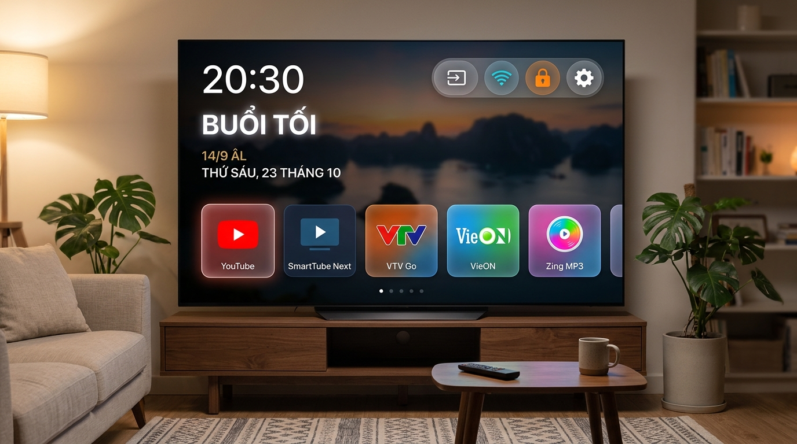
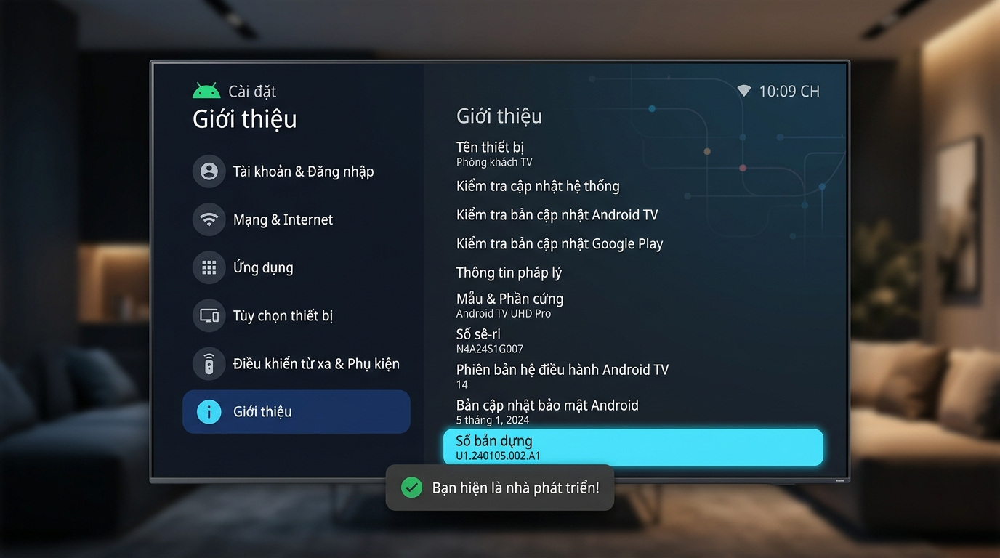
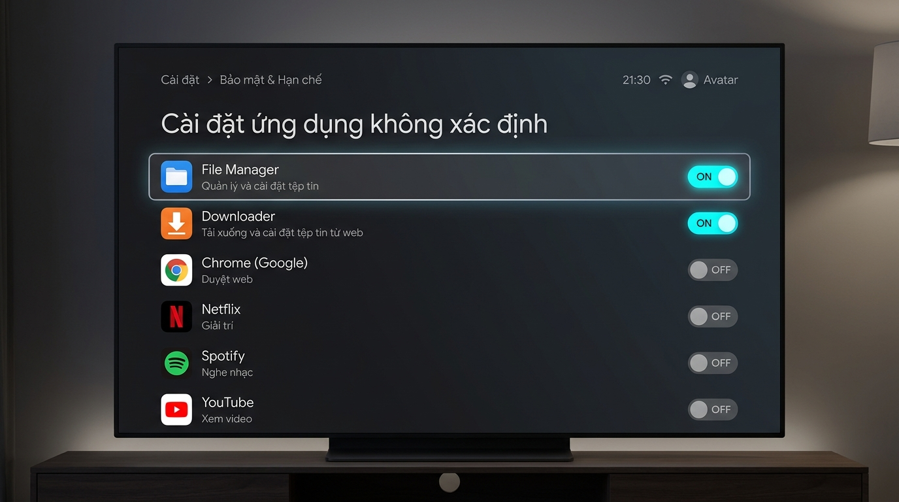
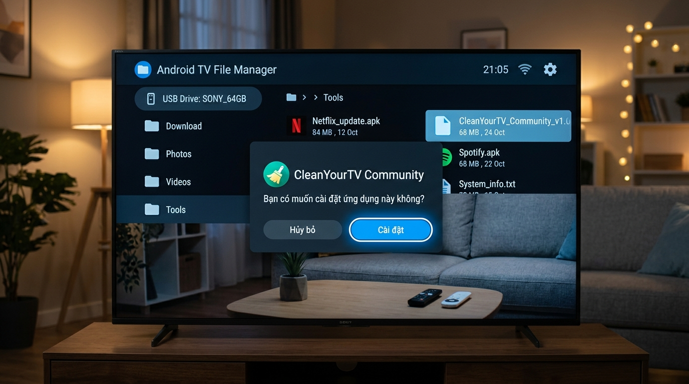
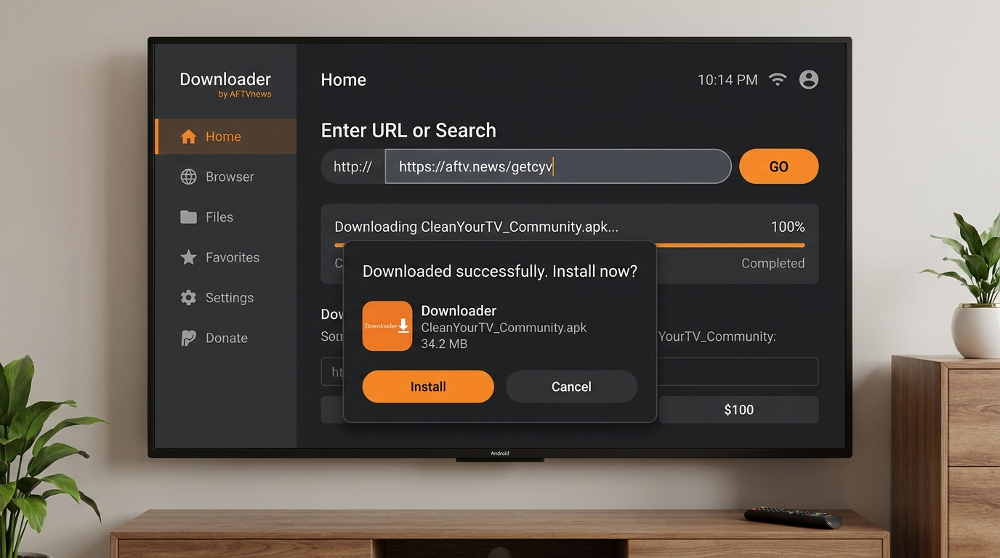

<p align="center">
  
</p>

# 📺 CleanYourTV - Vietnam Edition (Bản Việt Hóa & Tối Ưu Cho Gia Đình)

<p align="center">
  <a href="https://github.com/dvchung43/cleanyourtv-vn/releases/latest"></a>
  <a href="https://github.com/dvchung43/cleanyourtv-vn/releases/download/v1.0.0/CleanYourTV_Community_v1.0.apk"></a>
  
  
  
</p>

---

## 🌟 Giới Thiệu Tổng Quan

**CleanYourTV - Vietnam Edition** là phiên bản Launcher Android TV / Google TV tùy biến đặc biệt dành riêng cho người dùng Việt Nam. 

Khác với giao diện gốc của TV tràn ngập quảng cáo đề xuất, giật lag và gây xao nhãng cho trẻ nhỏ, **CleanYourTV** biến chiếc TV của bạn trở nên thanh lịch, tinh gọn như Apple TV với dung lượng siêu nhẹ **chỉ ~470 KB**, tốc độ phản hồi tức thì và hoạt động hoàn toàn độc lập, an toàn.

> 📥 **Tải về ngay bản APK mới nhất**:  
> 👉 **[Tải CleanYourTV_Community_v1.0.apk (v1.0.0)](https://github.com/dvchung43/cleanyourtv-vn/releases/download/v1.0.0/CleanYourTV_Community_v1.0.apk)**

---

## 🚀 Các Tính Năng Độc Quyền Trong Bản Việt Nam

### 🌙 1. Lịch Âm Thiên Văn Việt Nam (Chuẩn Hồ Ngọc Đức)
- Hiển thị ngày Âm lịch song song ngay cạnh đồng hồ và ngày Dương lịch (ví dụ: `14/9 ÂL`).
- Ứng dụng thuật toán thiên văn tính toán chu kỳ Mặt Trăng và ngày Sóc theo múi giờ Việt Nam (UTC+7).
- Tự động nhận diện chính xác các năm nhuận và tháng nhuận âm lịch, không cần kết nối internet hay cập nhật thủ công.

### 🔒 2. Khóa Trẻ Em Thông Minh (Kids Lock)
- **Bảo vệ bằng mã PIN:** Cho phép phụ huynh đặt mã khóa để ngăn con trẻ mở các ứng dụng giải trí hoặc thay đổi cài đặt khi chưa được phép.
- **Mã PIN động linh hoạt:** Hỗ trợ quy tắc mã bảo mật thông minh 6 số theo ngày giờ `ddMMHH` (ví dụ: ngày 23/10 lúc 16h mã PIN sẽ là `231016`, lúc 20h là `231020`), giúp phụ huynh không bao giờ sợ bị con trẻ nhìn trộm hay lộ mật khẩu cố định.
- **Phím tắt mở nhanh bằng điều khiển:** Mở khóa tiện lợi thông qua tổ hợp phím remote (như bấm liên tiếp 5 lần phím Tắt tiếng / Mute).
- **Giới hạn thời gian xem (Screen Time):** Giúp kiểm soát thời lượng xem TV khoa học cho các bạn nhỏ.

### 📺 3. Gim Mặc Định Ứng Dụng Xem TV Phổ Biến Tại Việt Nam
- Thanh Dock được cấu hình sẵn để tự động nhận diện và đưa các ứng dụng yêu thích của người Việt lên hàng đầu:
  - 🔴 **YouTube TV / SmartTube Next** (Ứng dụng xem video không quảng cáo).
  - 🔵 **VTV Go** (Kênh truyền hình quốc gia trực tuyến).
  - 🟢 **VieON / FPT Play** (Truyền hình, thể thao, phim truyện).
  - 🟣 **Zing MP3 / Spotify** (Nghe nhạc thư giãn).
- **Thuật toán tự lấp đầy (Auto-fill):** Nếu TV chưa cài một app nào đó trong danh sách trên, hệ thống sẽ tự động đưa các app đang có trên TV lấp đầy thanh Dock, tuyệt đối không có khoảng trống thừa.

### ⚡ 4. Siêu Nhẹ & Tối Ưu Tuyệt Đối
- Dung lượng APK chỉ **470 KB** (nhẹ hơn 100 lần so với các launcher thương mại).
- Chạy mượt mà trên mọi dòng TV có cấu hình RAM yếu (1 GB - 2 GB) từ Sony, TCL, Xiaomi, Casper, Coocaa đến TV Box, Chromecast.
- **100% Offline & Bảo Mật:** Không yêu cầu quyền `INTERNET`. Không thu thập dữ liệu cá nhân, không gửi thông tin người dùng ra bên ngoài.

---

## 🛠️ Hướng Dẫn Cài Đặt Chi Tiết Trên TV (Kèm Ảnh Minh Họa)

### 🟢 Bước 1: Bật Chế Độ Nhà Phát Triển (Developer Options)
1. Trên remote của TV, bấm nút **Cài đặt ⚙️**.
2. Chọn mục **Hệ thống** (hoặc **Tùy chọn thiết bị**) ➔ **Giới thiệu** (About).
3. Cuộn xuống dưới cùng tìm dòng **Số bản dựng** (Android TV OS build).
4. Nhấn phím **OK trên remote 7 lần liên tục** cho đến khi màn hình hiển thị: *"Bạn hiện là nhà phát triển!"*.

<p align="center">
  
</p>

---

### 🟢 Bước 2: Cho Phép Cài Đặt Ứng Dụng Ngoài (Unknown Sources)
1. Quay lại menu **Cài đặt** ➔ chọn **Bảo mật và hạn chế** (hoặc **Ứng dụng** ➔ **Quyền truy cập đặc biệt**).
2. Chọn **Cài đặt ứng dụng không xác định**.
3. Tìm ứng dụng bạn dùng để mở tệp (ví dụ **File Manager** nếu dùng USB, hoặc **Downloader**) ➔ Bật công tắc sang **BẬT (ON)**.

<p align="center">
  
</p>

---

### 🟢 Bước 3: Cài Đặt Ứng Dụng Lên TV (Chọn 1 trong 2 cách sau)

#### 👉 Cách A: Cài đặt bằng USB (Dành cho ai có sẵn USB)
1. Tải file [CleanYourTV_Community_v1.0.apk](https://github.com/dvchung43/cleanyourtv-vn/releases/download/v1.0.0/CleanYourTV_Community_v1.0.apk) về máy tính và copy vào USB.
2. Cắm USB vào cổng USB trên TV.
3. Mở ứng dụng quản lý tệp trên TV (*File Commander*, *X-plore*, hoặc *Trình quản lý tệp* có sẵn của TV).
4. Chọn ổ USB ➔ Chọn file **CleanYourTV_Community_v1.0.apk** ➔ Bấm **Cài đặt (Install)**.

<p align="center">
  
</p>

#### 👉 Cách B: Tải trực tiếp bằng link qua ứng dụng Downloader (Không cần USB)
1. Vào **Google Play Store (CH Play)** trên TV, tìm và cài đặt app **Downloader** (của *AFTVnews*).
2. Mở app Downloader, nhập đường link tải trực tiếp sau vào ô tìm kiếm:
   ```text
   https://github.com/dvchung43/cleanyourtv-vn/releases/download/v1.0.0/CleanYourTV_Community_v1.0.apk
   ```
3. Bấm **GO**, ứng dụng sẽ tự động tải file APK về TV 100%.
4. Hộp thoại hệ thống hiện lên ➔ Chọn **Cài đặt (Install)** là hoàn thành!

<p align="center">
  
</p>

---

## 🏠 Cách Đặt CleanYourTV Làm Màn Hình Chính Mặc Định

1. Sau khi cài đặt xong, bấm nút **HOME (biểu tượng ngôi nhà)** trên điều khiển TV.
2. Một bảng thông báo sẽ xuất hiện hỏi chọn màn hình chính ➔ Chọn **CleanYourTV** (hoặc **TV Home**).
3. Chọn mục **Luôn luôn (Always)**.
4. Từ nay về sau, mỗi lần mở TV hoặc bấm phím Home, giao diện CleanYourTV siêu mượt sẽ luôn xuất hiện ngay lập tức!

---

## ❓ Câu Hỏi Thường Gặp (FAQ)

<details>
<summary><b>1. Cài launcher này có làm mất bảo hành hay hại TV không?</b></summary>
Hoàn toàn không. CleanYourTV được cài đặt dưới dạng một ứng dụng thông thường (`.apk`), không can thiệp root máy, không can thiệp phân vùng hệ thống. Bạn có thể gỡ bỏ bất kỳ lúc nào trong phần Cài đặt ứng dụng của TV.
</details>

<details>
<summary><b>2. Ứng dụng có cần kết nối mạng để xem Lịch Âm không?</b></summary>
Không cần. Thuật toán Lịch Âm được tích hợp toán học thuần túy trực tiếp trong mã nguồn APK, chạy offline hoàn toàn 100%.
</details>

<details>
<summary><b>3. Làm thế nào để thay đổi ứng dụng trên thanh Dock?</b></summary>
Bạn có thể di chuyển con trỏ vào ứng dụng trên thanh Dock, nhấn giữ nút **OK** trên remote trong 2 giây để mở menu tùy chỉnh và chọn vị trí theo ý muốn.
</details>

---

## 📄 Giấy Phép & Ghi Nhận (Credits)
- Bản quyền mã nguồn phát hành dưới giấy phép mã nguồn mở **MIT License**.
- Phát triển dựa trên nền tảng dự án gốc tuyệt vời [CleanYourTV](https://github.com/Gathin23/cleanyourtv) của tác giả Gathin.
- Thuật toán Lịch Âm phát triển bởi tác giả Hồ Ngọc Đức.

---
<p align="center">
  <b>CleanYourTV - Vietnam Edition</b> • Tinh gọn chiếc TV của gia đình bạn ❤️
</p>
